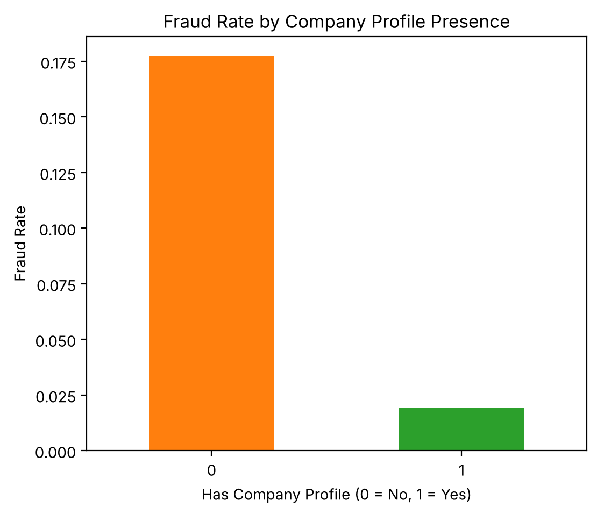
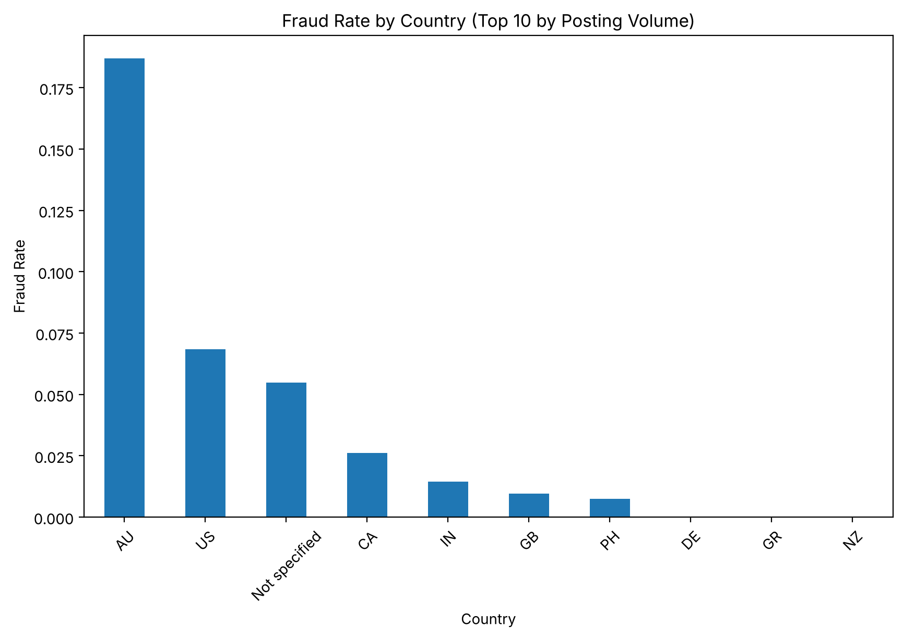

# Spotting Fake Job Postings

A data assessment of 17,880 public job postings (866, or 4.84%, labeled fraudulent) to find which features of a posting signal fraud. Built for ISDS 7070 in the LSU M.S. in Analytics. Python · pandas · seaborn · matplotlib.

## Key findings

| Signal | Fraud rate when missing / present | vs. overall 4.84% |
|---|---|---|
| Company profile | **17.7%** with none vs. 1.9% with one | about 3.7× higher when missing |
| Company logo | **15.9%** with none vs. 2.0% with one | about 3.3× higher when missing |
| Screening questions | 6.8% with none vs. 2.8% with some | |
| Remote (telecommuting) | 8.3% remote vs. 4.7% not remote | |

- **Missing company information is the strongest red flag.** Postings without a company profile or logo were fraudulent far more often than those with one.
- **Location matters.** Among the 10 countries with the most postings, Australia had the highest fraud rate (18.7% of 214), followed by the U.S. (6.9% of 10,656).
- **Fraudulent descriptions run a little shorter**, median 846 characters vs. 1,027 for legitimate postings.
- `salary_range` is missing for 84% of postings, so it can't be used as a signal without care.




## What's here

| Path | What it is |
|---|---|
| `notebooks/fake_job_postings_assessment.ipynb` | Data wrangling, missing-value review, engineered `has_company_profile` flag, charts, and narrative |
| `images/` | Charts from the notebook |

## Run it

1. Download `fake_job_postings.csv` from the Kaggle dataset [Real / Fake Job Posting Prediction](https://www.kaggle.com/datasets/shivamb/real-or-fake-fake-jobposting-prediction) (about 50 MB, so it isn't stored in this repo).
2. Put it in a `data/` folder next to `notebooks/`.
3. Install and open:

```bash
pip install pandas numpy matplotlib seaborn jupyter
jupyter notebook notebooks/fake_job_postings_assessment.ipynb
```

## Corrections since submission

- The remote-work chart's axis label was reversed; `telecommuting = 1` means remote.
- The summary originally said fraudulent descriptions were slightly longer; the medians show they are shorter.

The notebook was re-run after both fixes.

## Data

Employment Scam Aegean Dataset (EMSCAD), published by the University of the Aegean and shared on Kaggle.
